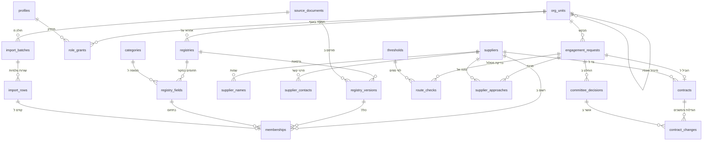

# אפיון בסיס הנתונים: מאגרי ספקים והתקשרויות

> עותק של [המסמך החי](https://claude.ai/artifact/HLeSTeziz1Kuy62MKe7N63), הועתק ב־16.11.2026. אם יש סתירה, המסמך החי הוא המקור.

טיוטה לאישור, 12.11.2026. המסמך מתאר את המצב הקיים ב-Supabase, את המבנה המוצע ואת תוכנית המעבר. שום דבר מהמוצע לא הוחל על הפרויקט החי.

## בקצרה

היום כל המידע יושב בטבלה אחת, `suppliers`, שבה כל שורה היא "שם ספק, תחום ומאגר" כטקסט חופשי. לכן אותו ספק מופיע כמה פעמים, אין קשר בין ספק למאגר או לתחום, ואין מקום לתוקף, לחוזים או להחלטות.

המבנה המוצע מפריד בין חמישה דברים שהיום מעורבבים: **מי הספק**, **באיזה מאגר ובאיזה תחום הוא רשום**, **מאיזה מסמך זה נלקח**, **מי בעירייה רשאי לראות ולשנות**, ו**מה קרה בהתקשרות עצמה**. סך הכול כ-25 טבלאות בשבעה תחומים.

דרושות ממך חמש החלטות, והן מרוכזות בסוף המסמך.

## המצב הקיים ב-Supabase

בדקתי את הפרויקט `jerusalem-consultants` בקריאה בלבד.

| נושא | מה מצאתי |
| --- | --- |
| טבלאות | שתיים: `suppliers` (788 שורות) ו-`activity_events` (39 שורות) |
| ספקים ייחודיים | 548 שמות שונים בתוך 788 השורות. 113 שמות מופיעים ביותר משורה אחת, ו-20 מהם ביותר ממאגר אחד |
| כפילויות מלאות | 76 שורות זהות לשורה אחרת בשם, בתחום ובמאגר |
| מאגרים | 8 מתוך כ-50 שהעירייה מפרסמת. השם שמור כטקסט בכל שורה |
| תחומים | 121 ערכים שונים כטקסט חופשי. ב-50 שורות כמה תחומים מחוברים ב-" / " בשדה אחד |
| פרטי קשר | ב-237 שורות אין דוא"ל וב-211 אין טלפון. 19 כתובות דוא"ל לא תקינות, וב-9 שורות יש כמה כתובות בשדה אחד. ל-34 ספקים פרטי קשר שונים בין שורות |
| מידע שקבור בהערות | תוקף מאגר (24 שורות), תוקף חוזה (67 שורות) וקוד תחום (כ-68 שורות) כתובים כטקסט בשדה ההערה |
| אימות | כל 788 השורות במצב "טעון בדיקה". אף שורה לא אומתה |
| אינדקסים | רק מפתח ראשי. אין אינדקס לחיפוש או לסינון |
| מיגרציות | אין אף מיגרציה רשומה. הסכמה נוצרה ידנית ולא ניתנת לשחזור |

**הרשאות.** RLS פעיל על שתי הטבלאות, והמדיניות מוודאת ש-`created_by` הוא המשתמש המחובר. זה טוב יותר ממה שהנחתי בסקירת הקוד, שנכתבה בלי גישה לפרויקט. נשארו ארבע בעיות:

- התפקיד `supplier_admin` נקבע ב-JWT של המשתמש, ויש רק תפקיד אחד. אין הבחנה בין צופה, עורך ומנהל, ואין שיוך לאגף.
- מי שמוסיף ספק יכול לסמן אותו בעצמו כ"מאומת". אין הפרדה בין מי שמזין למי שמאשר.
- הפונקציה `rls_auto_enable` היא `security definer` וניתנת להפעלה בידי משתמש אנונימי דרך ה-API. זו אזהרה של Supabase Security Advisor, ו[כך מתקנים אותה](https://supabase.com/docs/guides/database/database-linter?lint=0028_anon_security_definer_function_executable).
- הגנה מפני סיסמאות שדלפו כבויה ב-Auth. [הסבר של Supabase](https://supabase.com/docs/guides/auth/password-security#password-strength-and-leaked-password-protection).

## עקרונות התכנון

1. **כל עובדה נשמרת פעם אחת.** ספק הוא שורה אחת. מאגר הוא שורה אחת. הקשר ביניהם הוא שורה בטבלת שיוכים.
2. **לכל נתון יש מקור.** כל שיוך מצביע על מסמך מקור, גרסה ועמוד. הנוסח המקורי נשמר גם אחרי ניקוי ומיפוי.
3. **שלושה תאריכי תוקף נפרדים.** תוקף המאגר, תוקף השיוך של ספק למאגר ותוקף חוזה הם דברים שונים בחוק, ולכן נשמרים בנפרד.
4. **נתון גולמי לא נמחק.** מה שחולץ מ-PDF נכנס לאזור קליטה, ומשם מקודם לטבלאות הנקיות אחרי בדיקה. כך אפשר תמיד לחזור למקור.
5. **אין מחיקה, יש סטטוס.** רשומות מבוטלות או ממוזגות נשארות עם סימון. היסטוריה לא נעלמת.
6. **מי שמזין אינו מי שמאשר.** אימות ואישור נרשמים עם שם המאשר והזמן, והמערכת אוכפת שהם אדם אחר מהמזין.
7. **ההרשאות נאכפות בבסיס הנתונים**, לפי תפקיד ואגף ששמורים בטבלה ולא ב-JWT.
8. **פנימי קודם, ספק אחר כך.** כל טבלה מסומנת מראש: פנימית בלבד, או כזו שחלק ממנה ייפתח לספק בשלב הבא.

## המבנה המוצע

### 1. ארגון והרשאות (פנימי)

| טבלה | מה היא מחזיקה | שדות עיקריים |
| --- | --- | --- |
| `org_units` | מינהלים ואגפים של העירייה, בשתי רמות | שם, סוג (מינהל או אגף), יחידת אב, מקור, מאומת, פעיל |
| `profiles` | עובד עירייה שביקש גישה. שורה לכל משתמש Auth | שם, דוא"ל, תפקיד, אגף, מטרת השימוש, סטטוס (ממתין, פעיל, נדחה, חסום), מי אישר ומתי |
| `role_grants` | תפקיד של משתמש באגף | תפקיד (צופה, עורך, מנהל אגף, מנהל מערכת), אגף, מי נתן, תוקף, מועד ביטול |

זה המבנה שכבר קיים בטיוטה שמוזגה ב-PR #7, עם שמות קצרים יותר. הוא מחליף את התפקיד היחיד שב-JWT.

### 2. מאגרים ומקורות (ייפתח לספק)

| טבלה | מה היא מחזיקה | שדות עיקריים |
| --- | --- | --- |
| `registries` | מאגר אחד של העירייה, כ-50 בסך הכול | שם, אגף אחראי, סוג (מאגר יועצים לפי 3(8), רשימת ספקים למכרז זוטא לפי תקנה 8, אחר, לא ידוע), סטטוס |
| `source_documents` | קובץ שהעירייה פרסמה | קישור, שם קובץ, סוג, תאריך פרסום, תאריך הורדה, חתימת תוכן (hash), מספר עמודים |
| `registry_versions` | פרסום מסוים של מאגר | מאגר, מסמך מקור, תוקף מ-, תוקף עד, סטטוס בדיקה |
| `registry_fields` | תחום כפי שהוא כתוב במסמך המאגר | מאגר, נוסח מקורי, קוד תחום במקור (למשל 12.07), קטגוריה מנוהלת אם מופה |

ההפרדה בין `registries` ל-`registry_versions` פותרת את בעיית התוקף: כשהעירייה מפרסמת מאגר מעודכן, נוספת גרסה, והגרסה הישנה נשארת להיסטוריה. סוג המאגר נשמר כי מאגר יועצים ורשימת ספקים למכרז זוטא הם מנגנונים שונים בתקנות, ומנוע הכללים צריך לדעת מול מה הוא בודק.

### 3. ספקים (ייפתח לספק את הרשומה שלו)

| טבלה | מה היא מחזיקה | שדות עיקריים |
| --- | --- | --- |
| `suppliers` | ישות אחת לכל ספק | שם רשמי, שם מנורמל לחיפוש, סוג ישות (חברה, עוסק, עמותה, שותפות, מוסד, לא ידוע), סוג מזהה ומספר (ח"פ, ע"מ, ת"ז), סטטוס (פעיל, ממוזג, לא פעיל), ממוזג אל |
| `supplier_names` | שמות נוספים של אותו ספק | שם, סוג (כפי שהופיע במקור, שם מסחרי, שם קודם), מקור |
| `supplier_contacts` | פרטי קשר, שורה לכל ערך | סוג (דוא"ל, טלפון, כתובת, אתר), ערך, ערך מנורמל, תקין, ראשי, מקור |

שלוש נקודות חשובות:

- **מזהה רשמי.** המסמכים שהעירייה מפרסמת לא כוללים ח"פ או ע"מ, ולכן השדה יהיה ריק בהתחלה. בלי מזהה אי אפשר לקבוע בוודאות ששני שמות דומים הם אותו ספק, ולכן מיזוג ייעשה רק בהחלטת אדם.
- **ת"ז של עוסק יחיד היא מידע אישי.** היא תישמר בעמודה עם הרשאה נפרדת, ולא תוצג לצופה רגיל.
- **פרטי קשר בטבלה נפרדת**, כי לספק אחד יש כמה כתובות וטלפונים, והם מגיעים ממקורות שונים.

### 4. שיוך ספק למאגר (ייפתח לספק את השיוכים שלו)

| טבלה | מה היא מחזיקה | שדות עיקריים |
| --- | --- | --- |
| `memberships` | ספק רשום בגרסת מאגר, בתחום מסוים | ספק, גרסת מאגר, תחום במאגר, שם כפי שהופיע, עמוד במקור, תוקף מ-, תוקף עד, סטטוס (טעון בדיקה, מאומת, נדחה, הוסר), מי אימת ומתי, שורת הקליטה שממנה נוצר |

זו הטבלה המרכזית, והיא מחליפה את `suppliers` של היום. ספק שרשום בשלושה תחומים מקבל שלוש שורות שיוך וספק אחד. אילוץ ייחודיות מונע את הכפילויות המלאות שקיימות היום.

### 5. סיווג מנוהל (פנימי)

| טבלה | מה היא מחזיקה | שדות עיקריים |
| --- | --- | --- |
| `categories` | רשימת תחומים אחידה של העירייה, בשתי רמות | שם, תיאור, קטגוריית אב, מילים נרדפות, פעיל |
| `category_requests` | בקשה של עובד לתחום חדש | שם מוצע, תיאור, מבקש, סטטוס, החלטה מנומקת, קטגוריה שנוצרה או קושרה |

121 התחומים שקיימים היום נשארים בנוסח המקורי שלהם ב-`registry_fields`, וממופים בהדרגה לקטגוריות מנוהלות. כך "ייעוץ תנועה" במאגר אחד ו"יועץ תנועה ותחבורה" במאגר אחר יופיעו יחד בחיפוש, בלי לאבד את הנוסח המקורי.

### 6. קליטת נתונים (פנימי)

| טבלה | מה היא מחזיקה | שדות עיקריים |
| --- | --- | --- |
| `import_batches` | ריצת חילוץ אחת | מסמך מקור, גרסת הסקריפט, מי הריץ, מתי, מספר שורות, סטטוס |
| `import_rows` | שורה גולמית כפי שחולצה | אצווה, מספר שורה, עמוד, התוכן הגולמי (JSON), סטטוס (ממתין, קודם, נדחה, כפול), לאיזה שיוך קודם, הערת בודק |

הסקריפטים כותבים רק לכאן. קידום לטבלאות הנקיות נעשה אחרי בדיקה, ובסוף כל אצווה יש דוח התאמה: כמה שורות חולצו, כמה קודמו, כמה נדחו ולמה.

### 7. התקשרויות ובקרה (פנימי)

| טבלה | מה היא מחזיקה | שדות עיקריים |
| --- | --- | --- |
| `thresholds` | ספי ההתקשרות לפי תקנה 2, שורה לכל חודש | בתוקף מ-, עד, שלושת הספים, מדד, מקור, רשמי או מחושב |
| `engagement_requests` | בקשת התקשרות של אגף | אגף, נושא, מפתח נושא לבדיקת פיצול, שווי מוערך, כולל מע"מ, בסיס פטור מבוקש, ספק ושיוך אם נבחרו, סטטוס |
| `route_checks` | תוצאת מנוע הכללים, כפי שחושבה באותו רגע | בקשה, שורת הספים, הקלט המלא, מסלול, תקנה, סטטוס, מה חסר, אזהרות, גרסת המנוע |
| `supplier_approaches` | למי פנו בבקשה מסוימת | בקשה, ספק, תאריך, אופן הפנייה, השיב או לא, סכום ההצעה |
| `committee_decisions` | החלטת ועדה | בקשה או חוזה, סוג ועדה, תאריך, החלטה, תקנה, נימוק, תאריך פרסום, מסמך |
| `contracts` | חוזה שנחתם | ספק, בקשה, אגף, מספר חוזה, נושא, מתחילת-עד, שווי מקורי, כולל מע"מ, סטטוס |
| `contract_changes` | הגדלה, המשך או מימוש אופציה | חוזה, סוג, סכום, חודשים, פריט בחוזה, החלטת ועדה, תקנה |
| `audit_log` | מי שינה מה ומתי, בכל הטבלאות | משתמש, טבלה, רשומה, פעולה, ערך קודם וחדש (שדות מצומצמים) |
| `activity_events` | חיפושים וצפיות. קיימת היום ונשארת | משתמש, סוג אירוע, פרטים |

אלה חמשת החסרים שסימנו בתכנון המוקדם: בקשת התקשרות, טבלת ספים חודשית, יומן פניות לספקים, סכומי חוזה והגדלות מצטברות, והחלטות ועדה מקושרות. `route_checks` שומר את תשובת המנוע יחד עם הקלט והספים שהיו בתוקף, כדי שאפשר יהיה להראות בביקורת על מה התבססה כל בדיקה, גם אחרי שהספים התעדכנו.

## כללים טכניים לכל הטבלאות

| נושא | הכלל |
| --- | --- |
| מפתח ראשי | `uuid` עם `gen_random_uuid()` לישויות. `bigint identity` ליומנים ולשורות קליטה |
| מפתחות זרים | תמיד מוגדרים, ולכל אחד אינדקס. `on delete restrict` כברירת מחדל, כדי שלא יימחק ספק שיש לו חוזה |
| זמנים | `timestamptz` לרגעים, `date` לתאריכים משפטיים (תוקף, פרסום) |
| כסף | `numeric(14,2)` בשקלים, ולצידו תמיד עמודת "כולל מע"מ" |
| ערכים סגורים | `text` עם `check`, לא `enum` של Postgres, כי קל יותר להוסיף ערך במיגרציה |
| עמודות קבועות | `created_at`, `created_by`, `updated_at` בכל טבלה, שנקבעות בבסיס הנתונים ולא בלקוח |
| חיפוש | עמודת שם מנורמל שמחושבת אוטומטית, עם אינדקס `pg_trgm` לחיפוש בעברית ולזיהוי שמות דומים |
| ייחודיות | אילוץ על (ספק, גרסת מאגר, תחום) בשיוכים. אילוץ חלקי על (סוג מזהה, מספר) בספקים, כשהמזהה קיים |
| תוקף | `check` שתאריך הסיום אינו לפני ההתחלה. בספים, אילוץ שמונע חפיפה בין תקופות |
| RLS | פעיל על כל טבלה, מדיניות לכל פעולה ולכל תפקיד, `to authenticated` מפורש, `(select auth.uid())`, ופונקציות עזר בסכמה פרטית |
| פעולות מרובות טבלאות | אישור בקשה, קידום שורת קליטה ומיזוג ספקים הם פונקציה אחת בבסיס הנתונים, ולא כמה קריאות מהדפדפן |
| מיגרציות | כל המבנה נכתב כמיגרציות של Supabase CLI בריפו, ונבדק ב-CI לפני החלה |

## מי רואה ומי משנה

| תפקיד | קריאה | כתיבה |
| --- | --- | --- |
| משתמש ממתין | הפרופיל שלו ורשימת האגפים | בקשת הצטרפות אחת |
| צופה | ספקים, מאגרים, שיוכים מאומתים, קטגוריות | בקשה לקטגוריה חדשה |
| עורך אגף | כמו צופה, וגם שיוכים שטעונים בדיקה במאגרי האגף שלו | הצעת ספק ושיוך, בקשת התקשרות של האגף. לא יכול לאמת מה שהזין בעצמו |
| מנהל אגף | כמו עורך, וגם בקשות הצטרפות ובקשות התקשרות של האגף | אישור משתמשים לאגף, אימות שיוכים במאגרי האגף |
| מנהל מערכת | הכול, כולל יומן הביקורת | מבנה ארגוני, קטגוריות, מיזוג ספקים, ספים, קידום קליטה |
| ספק (שלב הבא) | הרשומה שלו, השיוכים שלו והפניות שנשלחו אליו | בקשת תיקון לפרטיו |

## תוכנית מעבר מהנתונים הקיימים

המעבר לא נוגע בטבלה הקיימת עד השלב האחרון, והאתר ממשיך לעבוד לאורך כל הדרך.

1. **גיבוי וייצוא.** ייצוא הסכמה הקיימת לריפו כמיגרציית בסיס, וגיבוי של 788 השורות.
2. **הקמת המבנה החדש** לצד הקיים, בענף פיתוח של Supabase ולא בפרויקט החי.
3. **העתקה לאזור הקליטה.** 788 השורות נכנסות ל-`import_rows` כמו שהן, אצווה לכל אחד מ-8 המאגרים.
4. **קידום אוטומטי של מה שחד-משמעי:**
   - 8 מאגרים, 8 מסמכי מקור ו-8 גרסאות.
   - 76 הכפילויות המלאות מסומנות "כפול" ולא מקודמות.
   - 50 השורות עם כמה תחומים מפוצלות לשיוך לכל תחום.
   - תוקף המאגר וקוד התחום מחולצים מההערות לשדות שלהם.
   - שם זהה אחרי נרמול הופך לספק אחד, כלומר כ-548 ספקים.
5. **תור לבדיקה אנושית:** 34 הספקים עם פרטי קשר סותרים, 19 כתובות הדוא"ל השגויות, 9 השורות עם כמה כתובות, ו-67 ההערות על תוקף חוזה, שלא ברור אם הן תוקף חוזה או תוקף שיוך.
6. **דוח התאמה:** מספר השורות בכל שלב, כדי לוודא ששום שורה לא נעלמה.
7. **מעבר האתר** לקריאה מהמבנה החדש, דרך תצוגה שמחזירה את אותם שדות שהוא מכיר היום.
8. **הטבלה הישנה נשארת לקריאה בלבד** לתקופה שתקבע, ואז נמחקת.

בנפרד מהמעבר, שני תיקונים קטנים שכדאי לעשות מיד: לבטל את הרשאת ההפעלה של `rls_auto_enable` למשתמשים, ולהפעיל הגנה מסיסמאות שדלפו.

## החלטות שדרושות ממך

1. **היקף.** לבנות עכשיו את כל שבעת התחומים, או להתחיל בתחומים 1 עד 6 (ספקים, מאגרים והרשאות) ולהוסיף את ההתקשרויות אחר כך? ההמלצה שלי: להקים את כל המבנה עכשיו, כי הקשרים בין הטבלאות משפיעים על התכנון, אבל למלא נתונים קודם בתחומים 1 עד 6.
2. **מזהה ספק.** האם יש לך מקור לח"פ או ע"מ של הספקים, למשל ממערכת הכספים של העירייה? בלי מזהה, זיהוי כפילויות יישאר ידני.
3. **67 ההערות על "תוקף חוזה"** במאגר פיתוח המשאב האנושי: האם זה תוקף החוזה עם הספק או תוקף הרישום שלו במאגר?
4. **פרטי קשר של עוסקים יחידים** הם מידע אישי. האם כל צופה מורשה יראה אותם, או רק עורכים ומנהלים?
5. **משתמשים.** היום יש שני משתמשים עם תפקיד אחד. האם לעבור כבר עכשיו למודל של אגפים ותפקידים, או להשאיר זמנית מנהל מערכת יחיד?
